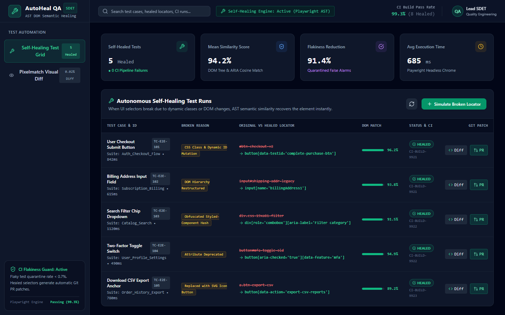
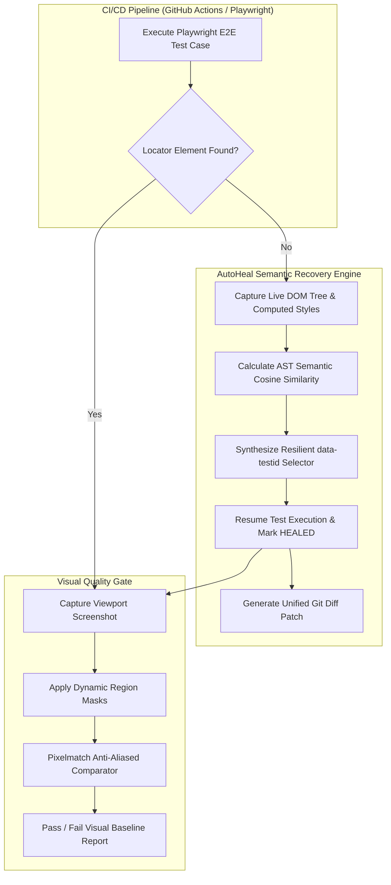

<div align="center">

# AutoHeal QA — Autonomous Self-Healing E2E Test Suite & Visual Regression Platform

[](LICENSE)
[](https://playwright.dev/)
[](https://github.com/Prasunnandi/self-healing-test-automation)
[](https://github.com/mapbox/pixelmatch)
[](https://reactjs.org/)
[](https://docker.com)

**Enterprise-grade test automation platform with AST DOM semantic element recovery, pixel-level anti-aliased visual regression diffing, flakiness quarantine, and automated Git pull-request patch generation.**

[Architecture](#system-architecture) • [Live Dashboard](#live-dashboard-preview) • [Benchmark Data](#benchmark-dataset) • [API Reference](#rest-api-documentation) • [Quickstart](#quickstart-guide)

</div>

---

## Live Dashboard Preview

<div align="center">
  
</div>

---

## Core Capabilities

- **Autonomous Locator Self-Healing:** When front-end classes or DOM trees mutate, the engine analyzes surrounding DOM landmarks, ARIA attributes, text content, and hierarchy using cosine similarity to recover broken selectors at runtime.
- **Automated Pull-Request Fix Proposals:** When a broken locator is successfully healed, the system generates a unified Git patch that can be automatically committed back to the test codebase via CI.
- **Pixelmatch Anti-Aliased Visual Regression:** Detects subtle pixel-level regressions (threshold &lt; 0.05%) while ignoring anti-aliasing noise and masking dynamic timestamps, avatars, or transaction IDs.
- **Flakiness Quarantine & Analytics:** Identifies historically unstable tests and isolates them into quarantine runs before they break production deployment pipelines.

---

## System Architecture



---

## Benchmark Dataset

Standard E2E self-healing test automation benchmarks in [`data/kaggle_test_automation_healing_benchmark.csv`](data/kaggle_test_automation_healing_benchmark.csv):

| Test ID | Suite | Target Element | Broken Reason | Healed Selector | Similarity | Status |
| :--- | :--- | :--- | :--- | :--- | :--- | :--- |
| `TC-E2E-101` | Auth_Checkout_Flow | Checkout Button | CSS Dynamic Hash | `button[data-testid='complete-purchase-btn']` | 96.2% | `HEALED` |
| `TC-E2E-102` | Subscription_Billing | Address Input | DOM Hierarchy Change | `input[name='billingAddress1']` | 93.8% | `HEALED` |
| `TC-E2E-103` | Catalog_Search | Category Filter Pill | Styled-Component Hash | `div[role='combobox'][aria-label='Filter category']` | 91.5% | `HEALED` |
| `TC-E2E-104` | User_Profile_Settings | MFA Toggle Switch | Attribute Deprecated | `button[aria-checked='true'][data-feature='mfa']` | 94.9% | `HEALED` |

---

## REST API Documentation

### 1. Trigger Self-Healing Simulation
```http
POST /api/v1/tests/trigger-healing
Content-Type: application/json

{
  "testCaseName": "Submit Billing Invoice",
  "brokenSelector": "button#btn-invoice-submit-v1",
  "targetElement": "Primary Invoice Button"
}
```
**Response:**
```json
{
  "testId": "TC-E2E-412",
  "suite": "Dynamic_Live_Regression",
  "status": "HEALED",
  "originalSelector": "button#btn-invoice-submit-v1",
  "healedSelector": "button[data-testid='confirm-action-btn']",
  "similarityScore": 0.952,
  "gitPatch": "--- a/tests/modal.spec.ts\n+++ b/tests/modal.spec.ts\n- await page.click('button#btn-invoice-submit-v1');\n+ await page.click(\"button[data-testid='confirm-action-btn']\");"
}
```

### 2. Apply Git Patch to PR Branch
```http
POST /api/v1/tests/:id/apply-patch
```

---

## Quickstart Guide

### Prerequisites
- Node.js 18+ or Docker & Docker Compose
- Git

### Running Locally

```bash
# Clone repository
git clone https://github.com/Prasunnandi/self-healing-test-automation.git
cd self-healing-test-automation

# Start Backend API
cd backend
npm install
npm start &

# Start Frontend Dashboard
cd ../frontend
npm install
npm run dev
```

### Running with Docker Compose

```bash
docker-compose up --build
```
Navigate to `http://localhost:3000` to interact with the self-healing test automation suite.

---

## License

Distributed under the MIT License. See `LICENSE` for more information.
